<div align="center">

# Samvid · संविद्

### Understand inherited disease risk: privately, kindly, in your own language

*Numbers from code. Words from AI. Decisions from people. Data stays with its owner.*

<br/>


**Future Health Digital Innovation Challenge 2026 · Fertility · Challenge 03**

[The problem](#the-problem) · [The solution](#the-solution) · [Global design](#global-by-design) · [Architecture](#system-architecture) · [Workflows](#core-workflows) · [Privacy](#privacy-by-design) · [Measurement](#what-we-measure) · [Roadmap](#delivery-plan) · [Docs](#documentation)

</div>

---

> [!IMPORTANT]
> **This is a working prototype on synthetic data.** The whole journey runs on one machine: the risk
> engine, the explanation pipeline with its safety checks, consent and family sharing, the care
> pathway, and the screens for people, counsellors and programme staff. Run it with
> `python Run_Samvid.py`.
>
> **Not yet done, and said plainly throughout:** no clinician has reviewed the content or the
> rules, no native speaker has reviewed the Hindi, Arabic text is pending approval, nobody has
> user-tested it, and no country's settings are reviewed. Details in
> [assumptions and limitations](docs/submission/assumptions_and_limitations.md).

## At a glance

| | |
|---|---|
| **Team** | Vigyan_Viveka_Vijaya |
| **The name** | *Samvid* (संविद्) is Sanskrit for knowledge and understanding, and also agreement and consent |
| **Languages** | English, Arabic and Hindi first, with more added per country |
| **What** | A companion that explains genetic carrier results, supports informed choices, and links people to qualified counsellors |
| **Who for** | Individuals and couples, families, genetic counsellors, physicians, and health programme managers |
| **Where** | Global by design, with per-country settings. Abu Dhabi is the first reference, and no country is supported until its settings are reviewed locally |
| **What makes it different** | Risk numbers come only from tested code, AI only explains them, and every sharing decision belongs to the individual |
| **What it never does** | Diagnose, tell anyone whether to marry or conceive, or contact relatives without the person's action |

---

## The problem

Couples related as second cousins or closer, and their children, were estimated at [10.4% of the world's population](https://pmc.ncbi.nlm.nih.gov/articles/PMC2868287), mostly across Africa, the Middle East and Asia (a 2009-era estimate). Screening is growing, but a result only helps once people understand it and can act on it. Abu Dhabi, which hosts this challenge, shows the pattern: its programme covers [570 genes and over 840 conditions](https://www.360dx.com/molecular-diagnostics/mandatory-premarital-genetic-carrier-screening-program-dubai-ids-risk-couples), yet the hardest part still comes **after the lab**.

```mermaid
flowchart LR
    A["<b>Screening</b><br/>Growing, varies by country"]:::warn --> B["<b>Result understood?</b><br/>Probabilistic, confusing"]:::bad
    B --> C["<b>Counselling</b><br/>Few accredited counsellors"]:::warn
    C --> D["<b>Informed choice</b><br/>Family and cultural pressure"]:::warn
    D --> E["<b>Care pathway</b><br/>Fragmented hand-offs"]:::warn
    E --> F["<b>Family informed</b><br/>A result implicates relatives"]:::bad

    classDef good fill:#E3F1D6,stroke:#5E8F36,color:#1F2433,stroke-width:2px
    classDef warn fill:#FDF0CF,stroke:#B8860B,color:#1F2433,stroke-width:2px
    classDef bad fill:#FBE0DA,stroke:#C9543C,color:#1F2433,stroke-width:2px
```

**Why getting this right matters**

- Misread results cause anxiety, stigma, family tension or false certainty.
- A carrier result says something about parents, siblings and cousins, so one person's data is never only theirs.
- Consanguineous marriage is a long-standing practice in many communities, so a good system supports **informed choice**, not judgement.
- Success can't be measured by cancelled marriages. That would be coercive, and it says nothing about understanding.

### The genetics in one picture

Consanguinity doesn't cause disease. It raises the chance that both partners inherited the same rare gene change from a shared ancestor. When both partners carry a change in the same recessive gene, **each pregnancy** has these chances:

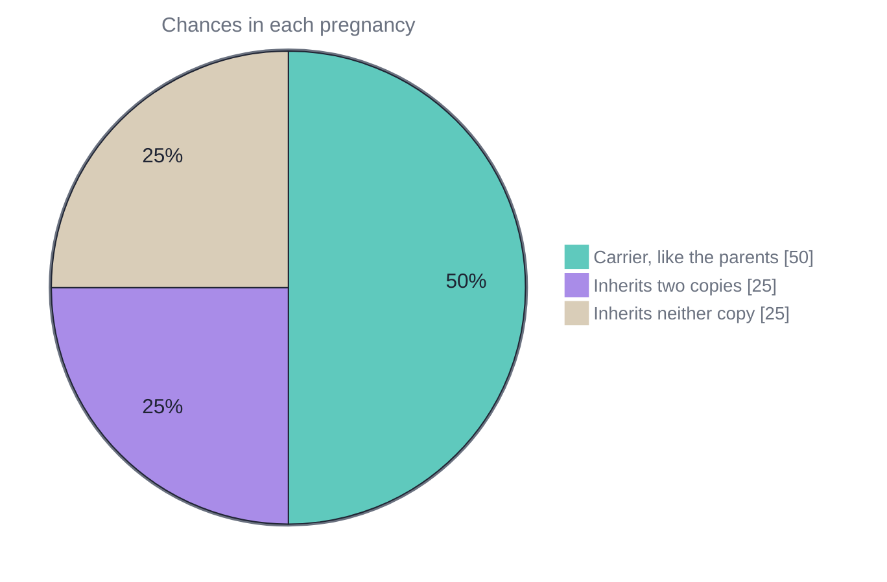

Chance has no memory, so these are the same for every pregnancy. They're chances, not a count of children, and risk is not a diagnosis.

---

## The solution

Each layer does only what it can be trusted to do. **The AI never computes a risk number, and a person always makes the decision.**

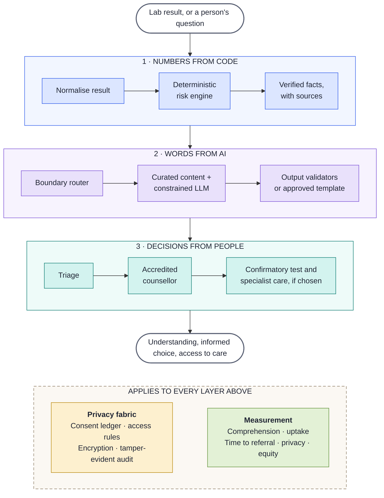

### How the six challenge requirements are met

| | Requirement | Planned approach | Main modules |
|---|---|---|---|
| **R1** | Risk explanation | Exact risk figures, icon arrays, three reading levels, plain English, Arabic and Hindi | `risk_engine` `explain` `kb` |
| **R2** | Values-sensitive choices | Options shown with equal weight, plus private values reflection that's never scored | `decision` `centres` |
| **R3** | Qualified human counselling | Every question labelled, with clinical or complex cases escalated to people | `explain/router` `triage` `booking` |
| **R4** | Privacy-preserving family workflows | Granular, revocable consent, couple-only match, anonymous family invitations, access log | `privacy` |
| **R5** | Safe linkage to services | Traceable pathway from result to counselling, testing and specialist care | `pathway` |
| **R6** | Measurable comprehension and access | Teach-back, uptake and time-to-referral metrics, split by language and literacy | `assessments` `analytics` |

---

## Global by design

Samvid isn't tied to one country. The safety core stays the same everywhere, and everything that differs by country is held in a **country pack**: settings, not code. Abu Dhabi is the first reference pack, because the challenge is hosted there.

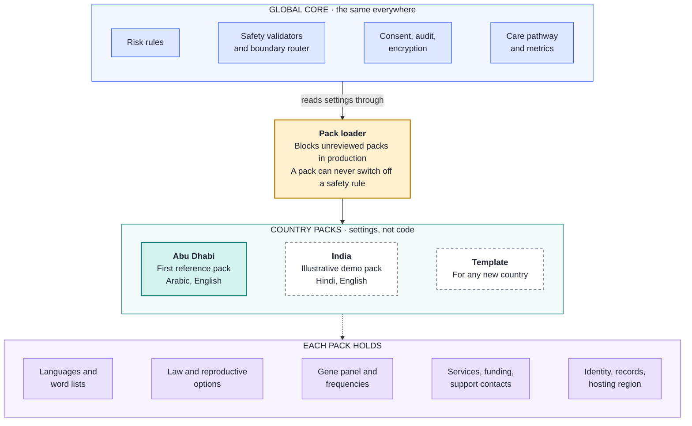

- **First two packs:** Abu Dhabi (Arabic and English) and India (Hindi and English). India is labelled illustrative until it's reviewed.
- **Adding a country needs no code change**, only a reviewed pack.
- **No country counts as supported until local clinicians and legal advisers have reviewed its pack.** "Global" describes the design, not today's coverage.
- **Where accredited counsellors are scarce,** the pack names the qualified human. If nobody qualified is available, the product says so honestly, and AI never fills the gap.
- **Genetic data stays in its country** by default, with a separate deployment per country or region.

Read the full design in [docs/07](docs/07_Global_Design_and_Country_Packs.md).

---

## System architecture

A **modular monolith**: quick to build as one deployable app, with clear boundaries so modules can split later.

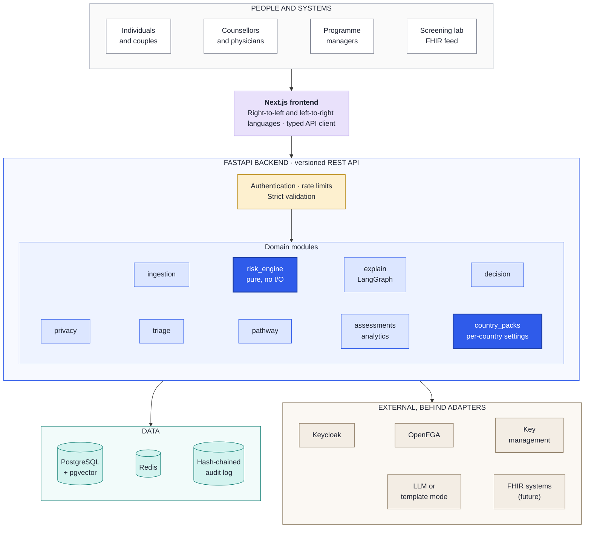

### Design principles

| Principle | What it means in practice |
|---|---|
| **Deterministic core** | The risk engine has no I/O or LLM access, so all its maths can be tested exhaustively |
| **Fail closed** | If authorisation, redaction or validation fails, the answer is deny or a safe fallback |
| **Uncertain means no number** | A variant of uncertain significance, an unknown gene or missing data produces no figure, and goes to a human |
| **Least privilege** | The LLM has no tools. The app's database role can't alter audit rows |
| **Graceful degradation** | With the AI off, approved templates still work and a human is always reachable |
| **Interoperable** | FHIR R4 in and out, to ease future health-system integration |

---

## Core workflows

### 1. From lab result to verified facts

The engine checks the riskiest cases first, and any uncertainty produces a referral instead of a number.

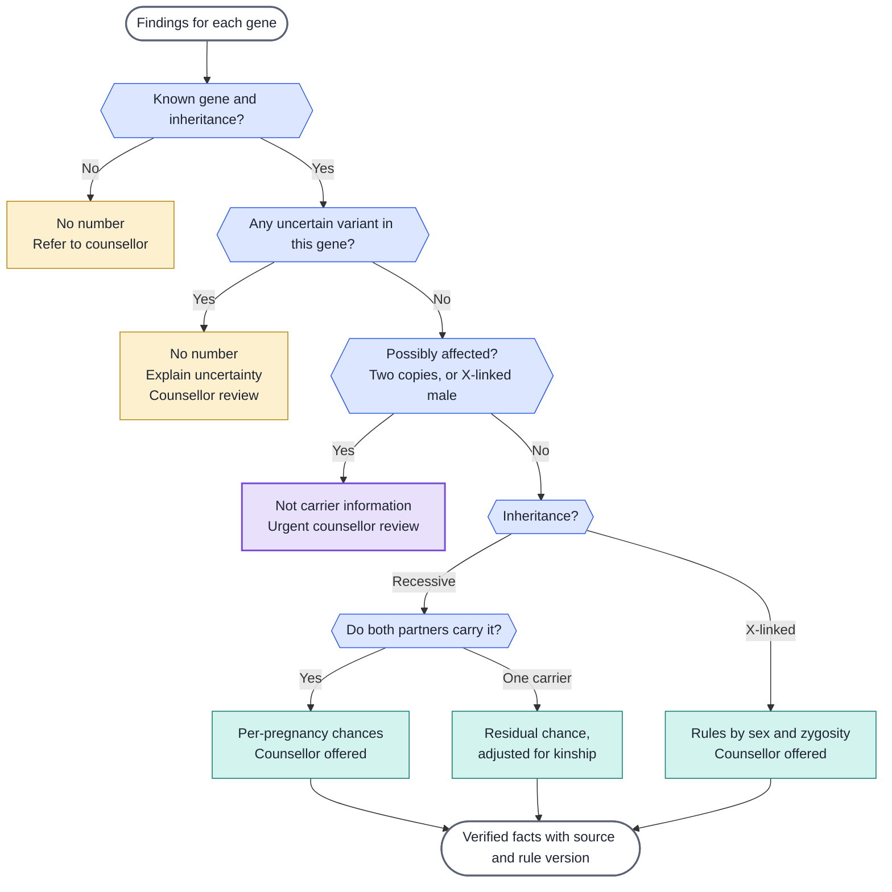

### 2. From a question to a safe answer

Every message gets a boundary label. The LLM refers to verified facts by ID, and code fills in the numbers, so a figure can't be invented or swapped.

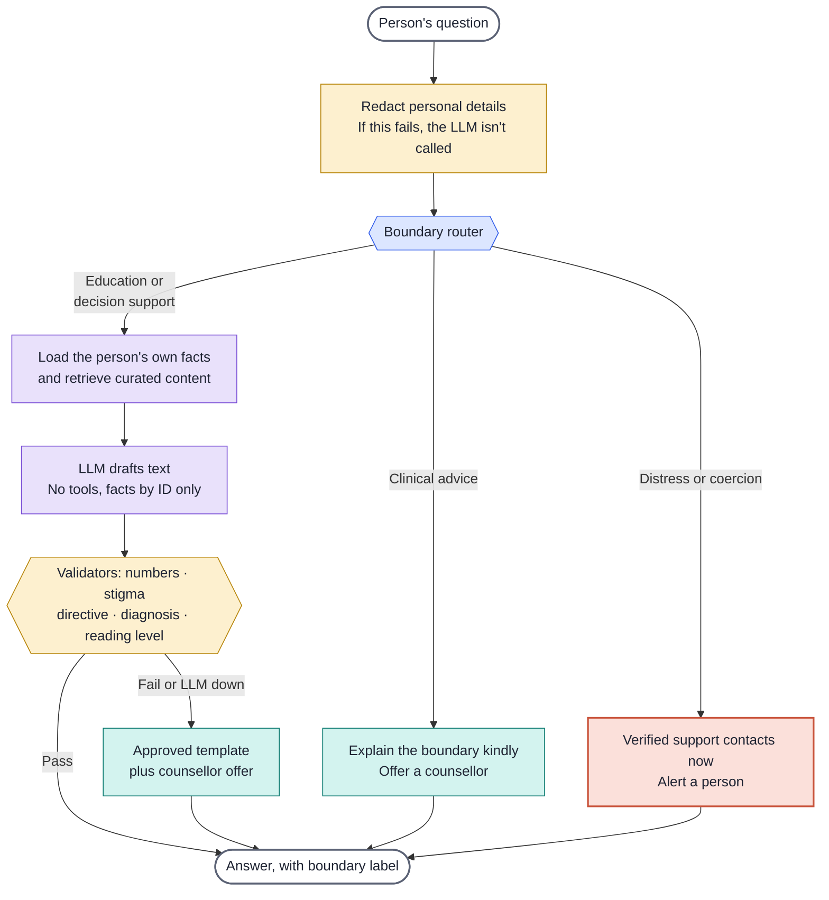

### 3. Couple-only match

Partners can compare results without exposing their other findings. If they choose different settings, the more private one wins. "No data" is never reported as "no shared finding".

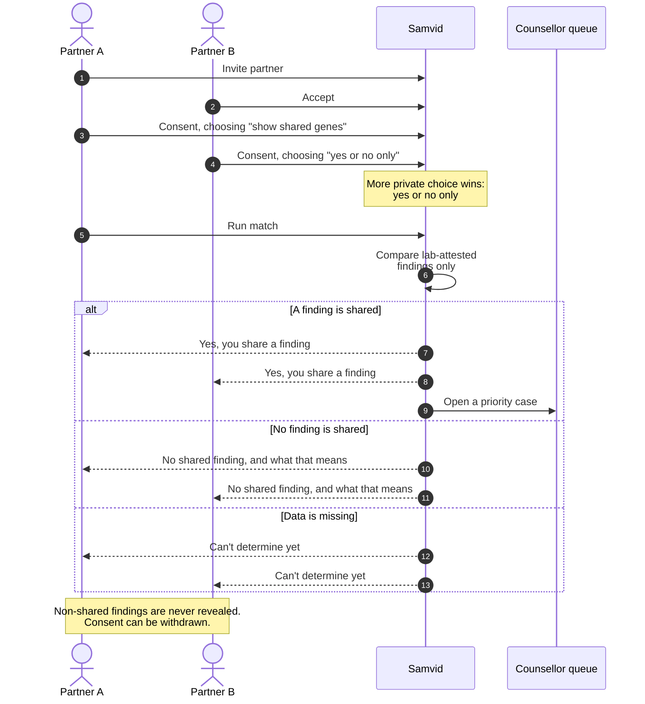

> [!NOTE]
> Couple-only match limits what partners see. The server still processes the data, and a person with one finding can infer the gene from a "yes". The product will say so plainly. Private set intersection is planned for matching **between institutions**.

### 4. Care pathway

**A person can decline at any point**, and that's a valid choice, not a failure. P1 and P2 cases go straight to counselling, and a confirmatory test that doesn't confirm the finding is recorded as its own outcome.

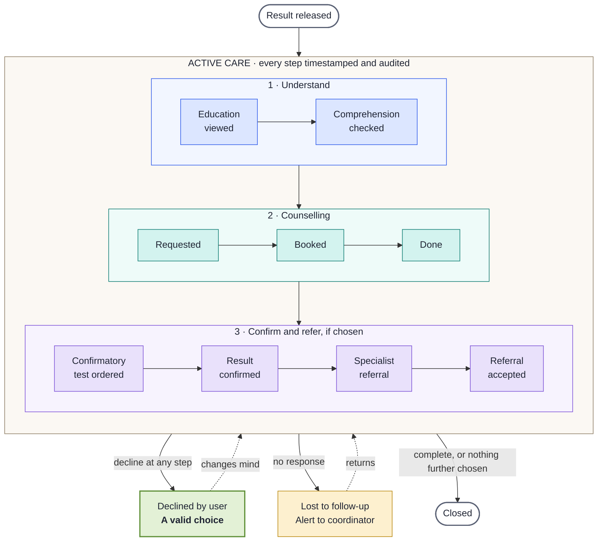

### 5. Triage: who gets a human, and when

Transparent, reviewable rules, not a black-box model. Every case records why it got its priority.

| Priority | Triggered by | Target time |
|---|---|---|
| **P1 Urgent** | Distress, a shared finding during pregnancy, or a possibly affected adult | 24 hours. Distress also gets support contacts immediately |
| **P2 High** | Both partners carry the same gene, an X-linked finding in a woman, or several shared genes | 72 hours |
| **P3 Standard** | Uncertain variant, questions on extended testing, or teach-back missed twice | 7 days |
| **P4 Optional** | A person asks for a human, with no other trigger | Next available |

These rules and times are configurable, and need clinical review.

---

## Privacy by design

Genetic data is permanent and shared across a family, so the most private setting is the default.

### Each person chooses how much to share

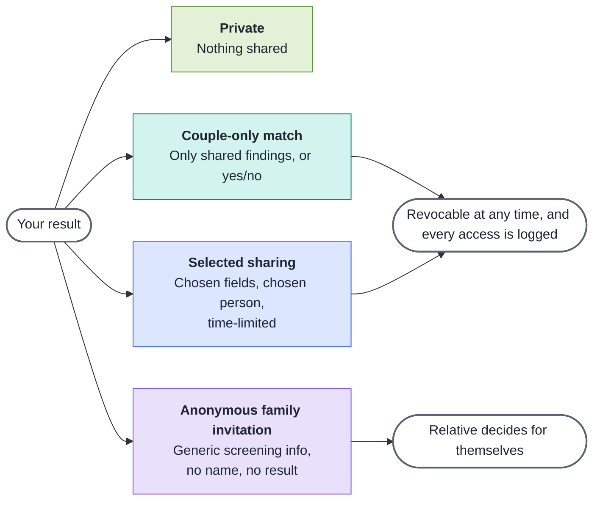

### What the AI is allowed to see

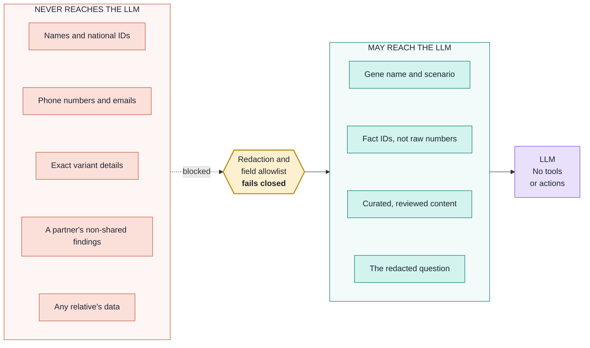

**Other planned controls**

| Control | Purpose |
|---|---|
| Field-level AES-256-GCM encryption | Genetic findings are unreadable in the database, and ciphertext is bound to its row |
| Relationship-based access (OpenFGA) | Models partners, relatives and counsellors, and denies access if the check fails |
| Hash-chained audit log | Tampering becomes detectable, and it powers the "who saw my data" view |
| Break-glass access | Access outside an assignment needs a stated reason and is flagged for review |
| Data minimisation | No raw genomes stored, and benign variants dropped on arrival |

---

## What we measure

Requirement 6 asks for evidence, so each metric is designed to be split by **language and literacy level**, to show who the system is failing.

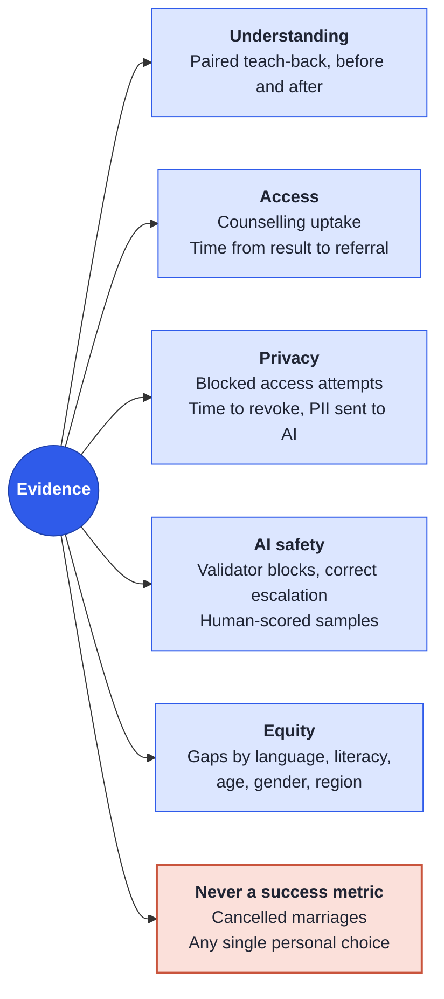

---

## Delivery plan

Six phases from 5 to 20 November 2026, with a target to submit a day early. Every objective, check and issue is cross-verified in [CROSS_VERIFICATION.md](docs/phases/CROSS_VERIFICATION.md).

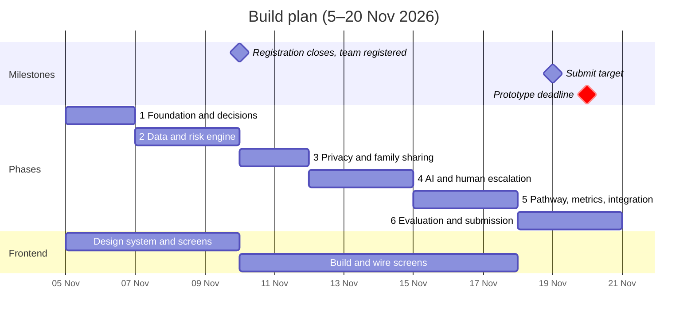

| Phase | Goal | Done when | Plan |
|---|---|---|---|
| **1** | Foundation, decisions, compliance baseline | Registered, scope locked, stack runs from a clean clone, audit tamper test passes | [Phase 1](docs/phases/PHASE_1_Foundation.md) |
| **2** | Genomic data and deterministic risk engine | Hand-worked risk answers match, and correct risk appears on screen | [Phase 2](docs/phases/PHASE_2_Genomic_Data_and_Risk_Engine.md) |
| **3** | Privacy fabric and family sharing | Privacy tests pass, and no partner-only data appears in any output | [Phase 3](docs/phases/PHASE_3_Privacy_and_Family_Sharing.md) |
| **4** | AI explanation and human escalation | Safe answers in English, Arabic and Hindi, even with the LLM off, and cases reach a counsellor | [Phase 4](docs/phases/PHASE_4_AI_Explanation_and_Escalation.md) |
| **5** | Care pathway, measurement, integration | Full demo journey works in both languages, with traceable metrics | [Phase 5](docs/phases/PHASE_5_Care_Pathway_Measurement_Integration.md) |
| **6** | Evaluation, hardening, submission | Honest safety report and limitations, and submitted with confirmation saved | [Phase 6](docs/phases/PHASE_6_Evaluation_and_Submission.md) |

### Run it

```bash
python Run_Samvid.py
```

On a first run it introduces the project, checks what you have installed and offers to install
what's missing, asks for a Gemini API key if you have one and saves it for you, builds everything,
creates demo accounts with synthetic lab reports, prints where to go, and then shows live activity
from the web app and the API in your terminal. Each run is also written to `logs/`, with secrets
removed.

**You need Docker Desktop.** Everything else it can install or do without:

| | |
|---|---|
| [uv](https://docs.astral.sh/uv/) | For the demo accounts. The launcher offers to install it |
| [Ollama](https://ollama.com) | Optional. With `ollama pull qwen2.5:3b`, an AI model drafts answers without anything leaving your computer |
| A Gemini API key | Optional, from [aistudio.google.com/apikey](https://aistudio.google.com/apikey). Without any model, reviewed text answers instead |
| Node.js | Only for the browser tests; the web app is built inside Docker |

| Command | Does |
|---|---|
| `python Run_Samvid.py` | Set up if needed, start everything, show live activity |
| `--setup` | Walk through the first-run setup again, including the AI key |
| `--status` | What's running, and which AI model will answer |
| `--check` / `--verify` | The smoke test, or that plus the load test and a scan of the logs for personal data |
| `--eval` | The safety evaluations, per language |
| `--security` | Every scanner, with the outputs saved |
| `--stop` / `--reset` | Stop, or delete all the data (it asks first) |

### Current status

| Area | State |
|---|---|
| Backend foundation: API security, database, audit trail, local stack | **Built and tested** |
| Risk engine, encryption, lab report ingestion, synthetic data, country packs | **Built and tested**, on placeholder gene values with no clinical review |
| Consent ledger, couple match, family invitations, access log, break-glass, redaction | **Built and tested** |
| Screens for people, counsellors and programme staff, in English and Hindi | **Built and tested** in a real browser against the real stack |
| AI explanation with safety checks, options, values, counsellor queue | **Built and tested**. Gemini or local Ollama, with reviewed text as the fallback |
| Care pathway, booking, FHIR referrals, centre finder, understanding checks, dashboards | **Built and tested** |
| Safety evaluation, security scans, submission documents | **Built**, with results and gaps in [docs/evaluation](docs/evaluation/) and [docs/security](docs/security/) |
| Routing recall target (95% per language) | **Not met**: measured at 5 of 59 hold-out questions still answered automatically. Reported, not hidden |
| Clinical review | **Not started**: no reviewer yet |
| Native-speaker review; Arabic text | **Not started**: Hindi unreviewed, Arabic pending approval |
| User testing | **Not run**: the protocol is ready, and no figures are invented in its place |

---

## Tech stack

All planned, per [docs/backend.md](docs/backend.md) and [docs/frontend.md](docs/frontend.md). Versions get pinned during Phase 1.

| Layer | Choice | Why |
|---|---|---|
| **Backend** | Python 3.12, FastAPI, Pydantic v2 | Strong AI and genomics ecosystem, strict validation, generated API contract |
| **Data** | PostgreSQL 16 with pgvector, SQLAlchemy 2, Alembic, Redis, Celery | One store for relational data and vectors, plus background jobs |
| **Identity and access** | Keycloak (OIDC), OpenFGA | Standard login, and relationship-based rules that fit family data |
| **AI** | LangGraph, an OpenAI-compatible LLM (Azure OpenAI or Jais), BGE-M3 embeddings | Explicit, testable pipeline with strong Arabic options |
| **Privacy and security** | AES-256-GCM, Vault or Key Vault, OpenFGA, word-list redaction | Envelope encryption, relationship checks that deny on any failure, and only listed words reaching an LLM. Private set intersection between institutions is a possible later step, and isn't built |
| **Interoperability** | FHIR R4 | Common language of health-system integration |
| **Note** | The challenge is technology-neutral, so these are our choices, not requirements | |
| **Frontend** | Next.js 15, TypeScript, Tailwind, shadcn/ui, next-intl | Fast multi-page build with accessible components and right-to-left support |
| **Visuals** | Custom SVG, Recharts or ECharts, Motion | Precise risk visuals, with a reduced-motion option |
| **Quality** | pytest, Hypothesis, Playwright, axe-core, ruff, mypy, gitleaks, trivy | Property tests for risk maths, plus accessibility and security checks |

---

## Repository structure

```text
Future Health/
├── README.md                 You are here
├── brain.md                  Mandatory project log: what, how and why
├── CLAUDE.md                 Rules for AI assistants
├── problem statement.md      The challenge text
│
├── backend/
│   ├── app/
│   │   ├── risk_engine/      Deterministic risk maths (pure, no I/O)
│   │   ├── explain/          Router, LLM pipeline, validators, templates
│   │   ├── privacy/          Encryption, audit, consent, matching, invitations
│   │   ├── triage/           Priorities, assignment, case summaries
│   │   ├── pathway/          Care state machine, FHIR mapping
│   │   ├── decision/         Options and values reflection
│   │   ├── kb/               Curated content (English, Arabic, Hindi; 3 levels)
│   │   ├── assessments/      Teach-back and adapted instruments
│   │   ├── analytics/        Metrics and fairness
│   │   ├── ingestion/        Lab results to minimal encrypted findings
│   │   ├── country_packs/    Loads and validates per-country settings
│   │   └── api/, core/, db/, models/, schemas/, repositories/, ...
│   ├── alembic/              Database migrations
│   ├── packs/                Country packs: law, options, languages, services
│   ├── synthetic/            Synthetic population and demo personas
│   └── tests/                unit, api, eval
│
├── frontend/
│   ├── app/                  Public site, user app, counsellor console, dashboards
│   ├── components/           ui, layout, motion, risk, charts
│   ├── lib/                  API client, auth, i18n
│   ├── messages/             English, Arabic and Hindi text
│   └── tests/e2e/            End-to-end and accessibility tests
│
├── infra/                    Docker Compose, OpenFGA model, Keycloak, Postgres
├── scripts/                  Runbooks
└── docs/
    ├── phases/               The 6-phase plan with verification checks
    ├── submission/           Technical docs, limitations, pilot plan, demo
    ├── clinical/             Options, rule review, content review
    ├── compliance/           Legal baseline
    ├── security/             Threat model, checklist
    └── evaluation/           Safety report, comprehension test
```

---

## Documentation

| Read this | To… |
|---|---|
| [Documentation map](docs/README.md) | Find anything, and see which document wins when they disagree |
| [Project review](docs/04_Project_Review_Issues_and_Improvements.md) | See known issues and what to do first |
| [Competition requirements](docs/submission/competition_requirements.md) | See official dates, FAQ answers and judging criteria |
| [Phase overview](docs/phases/00_PHASE_OVERVIEW.md) | See the plan, scope tiers and critical path |
| [Global design](docs/07_Global_Design_and_Country_Packs.md) | See how Samvid works across countries |
| [Problem statement](problem%20statement.md) · [Problem understanding](docs/01_Problem_Understanding.md) | Understand the challenge and evidence |
| [Solution and plan](docs/02_Solution_Architecture_and_Plan.md) · [Features and roadmap](docs/03_Features_Limitations_Roadmap.md) | Understand the concept, features and limits |
| [Stitch prompts](docs/STITCH_PROMPTS.md) · [Backend guide](docs/backend.md) · [Frontend guide](docs/frontend.md) | Get engineering and design detail |
| [Project structure](docs/05_Project_Structure.md) · [Traceability](docs/06_Traceability_Matrix.md) | Trace requirements through files, tests and checks |

> [!WARNING]
> The specs contain known errors, including bugs in the sample code in `docs/backend.md`. Read them alongside the [project review](docs/04_Project_Review_Issues_and_Improvements.md).

---

## Getting started

Run the foundation built so far:

```bash
python scripts/generate_env.py
cd infra
docker compose up -d --build --wait
docker compose exec api python -m app.ops.check_services
```

The [runbook](docs/runbook_local_stack.md) covers tests and everything else. To contribute:

1. Read the latest entries in [brain.md](brain.md).
2. Pick up the next open sub-phase in the [phase plan](docs/phases/00_PHASE_OVERVIEW.md).
3. Work toward its cross-verification checks, and close the issues it lists.
4. **Log what you did, how and why in [brain.md](brain.md).** This is mandatory for every change.

## Responsible use

- **Synthetic data only.** This repo must never contain real genetic or personal data. The organisers provide no data, so we generate our own and [declare every source](docs/submission/data_sources.md).
- **Not medical advice.** This is a competition prototype on synthetic data. It isn't a medical device and has not been clinically validated.
- **Legal review pending.** A real pilot in any country would need a licensed local health partner and regulatory approval.

## Competition

Built by team **Vigyan_Viveka_Vijaya** for the [Future Health Digital Innovation Challenge 2026](https://hack2skill.com/event/futurehealthchallenge/). The team is registered, and prototypes are due 20 Nov 2026. Dates may change, so check the challenge page. This is an independent entry, with no endorsement from any organiser or partner implied.

**IP and licence:** intellectual property stays with the team, under the challenge FAQ, and the code may be requested for evaluation. No licence has been chosen yet.
