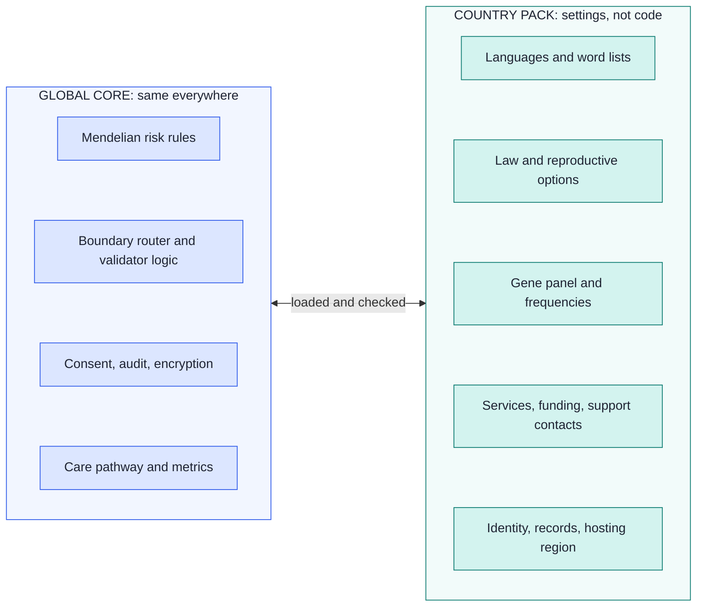

# 07 — Global Design and Country Packs

**Decision (5 Nov 2026):** Samvid is a **global product**. It's not limited to Abu Dhabi.

**In one line:** one shared core everywhere, with everything that differs by country held in a **country pack**. Abu Dhabi is the first pack, because the challenge is hosted there.

> **Status:** design only. No pack or loader code exists yet. No country is "supported" until its pack has been reviewed locally.

---

## 1. Why global

| Evidence | Source |
|---|---|
| The challenge asks for "solutions to global health needs", from teams "worldwide" | [Challenge page](https://hack2skill.com/event/futurehealthchallenge/) |
| "Do we need to be in the UAE? No. The build runs online." | [Competition requirements](submission/competition_requirements.md) |
| Couples related as second cousins or closer, and their children, were estimated at **10.4% of the world's population**. This is a 2009-era estimate and is known to be incomplete | [Bittles and Black, PNAS 2010](https://pmc.ncbi.nlm.nih.gov/articles/PMC2868287) |
| The highest rates are in north and sub-Saharan Africa, the Middle East, and west, central and south Asia | Same |
| Couples who see themselves as unrelated can still share ancestry, through marriage within a clan, tribe, caste or biraderi | Same |
| Genetic counsellors are scarce in many countries, and low- and middle-income countries report some of the largest gaps | [Bangladesh review](https://www.ncbi.nlm.nih.gov/pmc/articles/PMC8034097/) · [Pakistan review](https://www.ncbi.nlm.nih.gov/pmc/articles/PMC11658544/) |

## 2. Why Abu Dhabi stays as the first pack

"Global" must not mean "generic". We recommend keeping Abu Dhabi as the first worked example:

- The text of Challenge 03 is framed around Abu Dhabi's screening programme.
- The award describes a "potential pathway beyond the Challenge", and the host is the most realistic first pilot partner.
- A product proven in depth in one place is more credible than a thin product claimed for everywhere.

**The pitch:** *built for the world, proven first in Abu Dhabi.*

## 3. What's shared and what's in a pack

| Pack file | Holds | Abu Dhabi example | Why it can't be global |
|---|---|---|---|
| `pack.yaml` | Name, status, reviewers, languages, version | `status: reference` | A pack must state who reviewed it |
| `options.yaml` | Reproductive options available, with source | Fostering (kafala), and no donor option, pending confirmation | Law and faith differ sharply by country |
| `legal.yaml` | Consent form, retention, data residency, right not to know, licensing | Decree-Law 49/2023, Federal Law 2/2019 | Each country has its own law |
| `panel.yaml` | Screening panel, carrier frequencies, detection rates | 570-gene programme panel | Variants and frequencies differ by population |
| `services.yaml` | Centres, counsellors, tele-genetics, funding notes | Primary-care centres, Al Amal | Care pathways are local |
| `support_contacts.yaml` | Verified crisis and support contacts | From a counsellor | Must be real and local |
| `identity.yaml` | National ID format, phone format, sign-in, health records | Emirates ID, UAE PASS, Malaffi | Formats and systems differ |
| `lexicon.yaml` | Which word lists to use per language and dialect | Gulf Arabic | Stigma is local, including words for clan or caste |
| `strata.yaml` | Regions and age bands for equity reporting | Abu Dhabi, Al Ain, Al Dhafra | Regions differ |

**Stays global:** inheritance maths, the "uncertain means no number" rule, non-directive rules, consent and audit behaviour, and the safety rules in `CLAUDE.md`. **A pack can make things stricter, but can never switch off a safety rule.**

## 4. Rules for packs

1. **No code changes to add a country.** Test: switching pack changes options, language and contacts with no code edit.
2. **Reviewed or labelled.** A pack states `status: reference`, `illustrative` or `draft`. Only a pack with named local clinical and legal review can be called supported, and production refuses anything else.
3. **Fail safe.** A gene missing from a pack gives "no number, refer", never a guess from another country's data.
4. **Data stays in its country.** Each pack names a hosting region. No genetic data crosses borders by default, and each country gets its own deployment.
5. **No false claims.** The product and pitch name only the reviewed packs. "Global" describes the design.

## 5. What's different outside Abu Dhabi

| Topic | Global reality | Design answer |
|---|---|---|
| **Few or no counsellors** | Some countries have no accredited genetic counsellors | The pack defines the qualified human: counsellor, tele-genetics, or a trained clinician. If nobody qualified is available, the product says so honestly and never lets AI fill the gap |
| **Little or no screening** | Many people can't access a test | Education and "how to find screening" must work with no result on file |
| **Screening isn't mandatory** | Testing is voluntary in many places | No assumption of a premarital programme or a lab feed; manual entry by a clinician may be needed |
| **Other languages and low literacy** | Many languages, right-to-left and left-to-right | Language packs, with voice mode more important in some places |
| **Religion and custom vary** | Not only Islamic contexts; caste, clan and biraderi matter too | Faith content is per pack and only on request. Consanguinity is never framed as one culture's issue |
| **Cost** | Many countries have no public funding | Funding notes are per pack, with an offline-friendly, low-cost path |
| **Sex-selection law** | Some countries restrict this, which affects X-linked counselling | A legal flag in the pack, plus counsellor-only handling |

## 6. Laws to check per country

These are starting points, not advice. Local counsel must confirm them before a pack is called reviewed.

| Region | Start with |
|---|---|
| UAE | Federal Decree-Law 49/2023 (human genome), Federal Law 2/2019 (health data), assisted-reproduction law |
| EU and UK | GDPR, which treats genetic data as a special category, plus national genetic-testing laws |
| USA | HIPAA, GINA, and state genetic privacy laws |
| Others | National data, health and reproductive law, and professional licensing |

## 7. What this means for the 20 Nov prototype

| Scope | Item |
|---|---|
| **Must have** | Pack framework, the Abu Dhabi reference pack, and the empty template, each labelled with its review status |
| **Strong demo moment** | Every country-specific setting on screen comes from the pack: a second country is a folder of settings, not a code change |
| **Roadmap** | More reviewed packs, partner onboarding, per-country deployments |

**Decided on 5 Nov 2026: India is the second pack. Reversed on 16 Nov 2026.** The prototype now ships Abu Dhabi only. A second pack was costing review attention that one unreviewed pack already needed, and a half-reviewed second country argues against the point it was meant to prove. `_template/` carries the structure instead, and the loader tests switch to a second country built from it.

### Languages

| Pack | Languages | Status |
|---|---|---|
| Abu Dhabi | English, with an Arabic translation | Reference, pending clinical and legal review. The Arabic is drafted, with no native-speaker review |

**Known limit:** Abu Dhabi's residents speak far more than English and Arabic, so these two don't reach everyone who would want screening. Any further language needs its own native-speaker review before it ships, and the pitch should say which languages are covered rather than implying the product speaks to everyone.

## 8. Effect on existing documents

- Issues are tracked as **S9** and **G1–G10** in the [review](04_Project_Review_Issues_and_Improvements.md#8-global-readiness-issues).
- The work is planned in [sub-phase 2.6](phases/PHASE_2_Genomic_Data_and_Risk_Engine.md#26-country-pack-framework).
- `docs/01`, `02`, `03`, `backend.md` and `frontend.md` still contain UAE details. They now carry a scope note, and those details describe the Abu Dhabi reference pack. The sample code in `backend.md` is not rewritten; G1–G10 say what must change when it's implemented.
