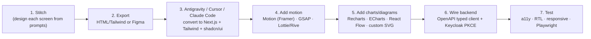
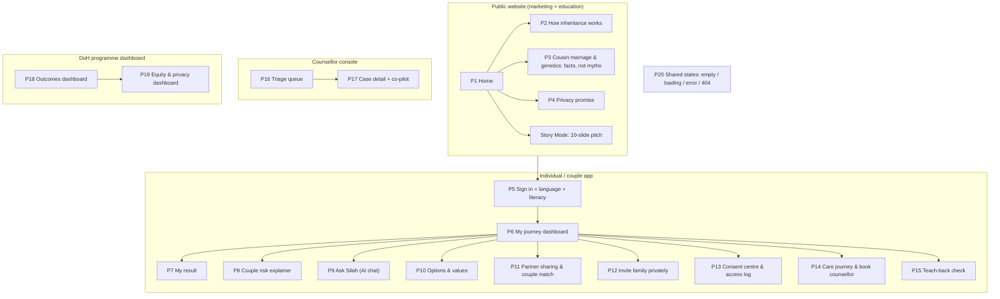

# frontend.md — Silah Frontend: Design System + Copy-Paste Prompts

> **Goal:** a **light-theme, "Ceramic Chromatic", colourful, animated**, multi-page website and web app, designed in **Google Stitch**, then built and animated with **Google Antigravity** (or Cursor / Claude Code) and wired to the backend in [backend.md](backend.md).
> **Style name, "Ceramic Chromatic":** glossy, soft-clay ("claymorphism") ceramic surfaces in a bright **tile-mosaic** palette inspired by Islamic and Emirati geometric ceramics. *If "cramistic" meant something else, change only §2 and the master prompt in §3; every page prompt reuses those tokens.*

---

## Table of contents
1. [Tool workflow (and alternatives)](#1-tool-workflow-and-alternatives)
2. [Design system: Ceramic Chromatic (light)](#2-design-system--ceramic-chromatic-light)
3. [Master prompt (paste first in Stitch)](#3-master-prompt-paste-first-in-stitch)
4. [Site map (multi-page / multi-slide)](#4-site-map-multi-page--multi-slide)
5. [Page prompts for Stitch (20 screens)](#5-page-prompts-for-stitch)
6. [Story Mode: 10-slide animated pitch site](#6-story-mode--10-slide-animated-pitch-site)
7. [Charts and diagrams spec](#7-charts--diagrams-spec)
8. [Animation spec + Antigravity prompts](#8-animation-spec--antigravity-prompts)
9. [Build and backend integration prompt (Antigravity)](#9-build--backend-integration-prompt-antigravity)
10. [Frontend security rules](#10-frontend-security-rules)
11. [Prompting tips for Stitch](#11-prompting-tips-for-stitch)
12. [Checklist](#12-checklist)

---

## 1. Tool workflow (and alternatives)



**Important:** Stitch produces **static screens** (layout, colour, components). It does not produce real animations or live charts. So:
- **Stitch prompts (§5)** describe layout and visual style, and include *motion notes* so the design leaves room for animation.
- **Antigravity prompts (§8, §9)** add the actual animation, charts and API wiring in code.

### Recommended stack (code stage)
| Need | Choice | Why |
|---|---|---|
| Framework | **Next.js 15 (App Router) + TypeScript** | Routing for many pages, SSR for public pages, easy i18n |
| Styling | **Tailwind CSS** + design tokens (CSS variables) | Stitch exports Tailwind, so the move to code is direct |
| Components | **shadcn/ui** (Radix primitives) | Accessible (keyboard, ARIA), themeable to the ceramic style |
| Animation | **Motion** (formerly Framer Motion), **GSAP ScrollTrigger** for story slides, **Lottie** / **Rive** for illustrations | Declarative React animation plus scroll storytelling |
| Charts | **Recharts** (simple), **Apache ECharts** (rich dashboards), custom **SVG** for icon arrays and Punnett squares | Precise control over risk visuals |
| Diagrams | **React Flow** (care pathway, family tree), **pedigreejs** (pedigree) | Interactive node diagrams |
| i18n + RTL | **next-intl**, `dir="rtl"`, Tailwind logical properties (`ms-`, `me-`, `ps-`) | Arabic-first |
| Data fetching | **TanStack Query** + **openapi-typescript** / **openapi-fetch** | Typed client generated from the backend OpenAPI |
| Auth | **Keycloak OIDC (Auth Code + PKCE)** via a Next.js BFF (`next-auth` Keycloak provider) | Tokens stay server-side in httpOnly cookies |
| Testing | **Playwright** + **axe-core** | E2E, accessibility, RTL snapshots |

### Alternative design / build tools
| Tool | Best for | Notes |
|---|---|---|
| **Google Stitch** (recommended) | Fast multi-screen UI from prompts; Figma/HTML export | Free (Google Labs), pairs naturally with Antigravity |
| **v0 by Vercel** | React + Tailwind + shadcn code directly | Produces code you can paste into Next.js; good for charts and dashboards |
| **Lovable** / **Bolt.new** | Full-stack prototype from a prompt | Quick, but less control over backend integration |
| **Figma + Figma Make / AI** | Polished design system, designer handoff | Use if a designer joins the team |
| **Framer (AI)** | Animated marketing / story site | Excellent for §6 Story Mode with built-in motion |
| **Uizard** | Wireframes from sketches | Early ideation |
| **LottieFiles / Rive** | Custom animated illustrations (DNA, tiles, family) | Export JSON or `.riv` for code |
| **Spline** | Light 3D ceramic objects (glossy tiles, DNA helix) | Use sparingly for the hero only |

---

## 2. Design system: Ceramic Chromatic (light)

### 2.1 Mood
Warm porcelain backgrounds · glossy, rounded "glazed tile" cards with soft clay shadows · bright mosaic accents (lapis blue, turquoise glaze, terracotta, saffron, rose clay, olive) · subtle Islamic geometric tile patterns at 4–6% opacity · friendly rounded illustrations of diverse Emirati families · calm, hopeful, never clinical-cold, **never alarming**.

### 2.2 Colour tokens
| Token | Hex | Use |
|---|---|---|
| `--porcelain` (bg) | `#FBF8F3` | App background |
| `--glaze` (surface) | `#FFFFFF` | Cards |
| `--sand` (surface-2) | `#F3EDE4` | Section bands, inputs |
| `--ink` (text) | `#1F2433` | Primary text (contrast 15:1 on porcelain) |
| `--slate` (text-2) | `#5B6275` | Secondary text (≥ 4.5:1) |
| `--lapis` (primary) | `#2F5BEA` | Primary buttons, links, focus |
| `--turquoise` (secondary) | `#14A89B` | Secondary actions, "carrier" in charts |
| `--terracotta` | `#E2725B` | Highlights, illustrations (not used for "danger") |
| `--saffron` | `#F4B740` | Badges, attention (non-alarming) |
| `--rose-clay` | `#E58FA8` | Illustrations, family elements |
| `--olive` | `#7BAE4E` | Success, completed steps |
| `--plum` | `#7A4FD6` | "Condition / affected" in risk charts (deliberately **not red**) |
| `--lilac` | `#B9AEF7` | Soft accents, AI chat bubble |
| `--line` | `#E6DED2` | Borders, dividers |

**Risk-visual palette (colour-blind safe, non-stigmatising):** affected = **plum** `#7A4FD6` + diagonal hatch; carrier = **turquoise** `#14A89B` + dots; neither = **sand** `#E9DFCF` + outline. Never use red or green for genetic outcomes. Always pair colour with a pattern and a text label.

**Gradients (glaze sheen):**
- Hero: `linear-gradient(135deg, #2F5BEA 0%, #14A89B 45%, #F4B740 100%)` at 12–18% over porcelain
- Card gloss: `linear-gradient(180deg, rgba(255,255,255,.9), rgba(255,255,255,0) 40%)` as a top highlight

### 2.3 Typography
| Role | Latin | Arabic | Size / weight |
|---|---|---|---|
| Display | **Readex Pro** | **Readex Pro** (supports both scripts) | 48–64 / 700 |
| Heading | Readex Pro | Readex Pro | 24–36 / 600 |
| Body | **Inter** | **IBM Plex Sans Arabic** | 16–18 / 400 (simple level: 18–20) |
| Numbers | Inter tabular-nums | Western digits (common in UAE) | — |
Line height 1.6 (Arabic 1.8). Max line length 68ch.

### 2.4 Shape, depth, texture
- Radius: cards **24px**, buttons **999px** (pill), inputs **16px**, chips **12px**.
- Clay shadow: `8px 10px 24px rgba(31,36,51,.08), -6px -6px 16px rgba(255,255,255,.9), inset 0 1px 0 rgba(255,255,255,.7)`.
- Pressed (inset clay): `inset 4px 4px 10px rgba(31,36,51,.08), inset -4px -4px 10px rgba(255,255,255,.9)`.
- Texture: an 8-point star geometric tile pattern (SVG) at 5% opacity on section bands; a mosaic-tile divider strip (small multicolour squares) between sections.

### 2.5 Motion principles
| Token | Value | Use |
|---|---|---|
| `--dur-xs` | 150 ms | Hover, press |
| `--dur-sm` | 250 ms | Toggles, chips |
| `--dur-md` | 400 ms | Cards entering, tabs |
| `--dur-lg` | 700 ms | Hero, slide transitions |
| `--ease-settle` | `cubic-bezier(0.22, 1, 0.36, 1)` | "Ceramic settle": fast start, soft landing |
| Spring | stiffness 260, damping 24 | Buttons, chips, icons |
Rules: animation **explains** things (inheritance, flow, progress) rather than decorating · no flashing · nothing loops forever except an idle hero at under 0.3 Hz · **`prefers-reduced-motion` → fades only**.

### 2.6 Accessibility and culture
- WCAG 2.2 AA: contrast ≥ 4.5:1, focus ring 3px lapis plus 2px offset, touch targets ≥ 44px.
- Full **RTL** mirroring for Arabic. Icons with direction (arrows) flip; charts keep their numeric axis order.
- Literacy toggle (Simple / Standard / Detailed) is always visible. Simple mode uses larger text and more icons.
- Voice button ("Listen") next to every explanation.
- Illustrations: modest dress, diverse ages, Emirati family settings, no medical gore, no sad or sick children.
- Copy is **non-directive** ("Your options", "The choice is yours"), **non-stigmatising** ("share a genetic finding", never "incompatible"), and makes clear that risk is not a diagnosis.

---

## 3. Master prompt (paste first in Stitch)

```text
Design system for "Silah" (صلة) — a bilingual (Arabic RTL + English) web app that helps Emirati
individuals and couples understand genetic carrier screening results privately and kindly.

STYLE: "Ceramic Chromatic" LIGHT theme. Warm porcelain background #FBF8F3, white glazed cards with
soft clay (neumorphic) shadows, 24px rounded corners, pill buttons, glossy top highlight on cards.
Bright mosaic-tile accent palette: lapis blue #2F5BEA (primary), turquoise glaze #14A89B (secondary),
terracotta #E2725B, saffron #F4B740, rose clay #E58FA8, olive #7BAE4E, plum #7A4FD6, lilac #B9AEF7.
Text ink #1F2433, secondary slate #5B6275, borders #E6DED2.
Subtle Islamic 8-point-star geometric tile pattern at 5% opacity on section backgrounds; thin
multicolour mosaic-tile divider strips between sections.

TYPOGRAPHY: Readex Pro for headings (Arabic + Latin), Inter for English body, IBM Plex Sans Arabic for
Arabic body. Generous spacing, max 68 characters per line, large readable text.

ILLUSTRATION: friendly, rounded, flat-3D clay-style illustrations of diverse Emirati families,
couples and counsellors; modest clothing; hopeful and calm; DNA strands drawn as colourful
ceramic beads; family trees drawn as connected ceramic tiles.

TONE: warm, private, respectful, non-judgmental, never alarming. Avoid red for risk. Use plum for
"condition", turquoise for "carrier", sand for "neither", always with patterns and labels.

COMPONENTS: top nav with language switch (العربية / English) and literacy toggle
(Simple / Standard / Detailed), a "Listen" voice button on explanations, privacy lock badges,
progress steppers, chips, clay cards, tabs, bottom sheet on mobile.

LAYOUT: responsive web (1440 desktop, 390 mobile). Accessible: WCAG AA contrast, 44px targets,
visible focus rings. Leave space for subtle animations (cards rising, numbers counting, icon grids
filling).
```

---

## 4. Site map (multi-page / multi-slide)



| # | Page | Route | Backend endpoint(s) |
|---|---|---|---|
| P1 | Home | `/[locale]` | — |
| P2 | How inheritance works | `/[locale]/learn/inheritance` | — (static + animation) |
| P3 | Facts not myths | `/[locale]/learn/cousin-marriage` | — |
| P4 | Privacy promise | `/[locale]/privacy` | — |
| P5 | Sign-in + preferences | `/[locale]/start` | Keycloak OIDC; `PATCH /v1/me` |
| P6 | My journey | `/[locale]/app` | `GET /v1/me/results`, pathway state |
| P7 | My result | `/[locale]/app/result` | `GET /v1/me/results` |
| P8 | Couple risk | `/[locale]/app/couple` | `GET /v1/me/risk`, `POST /v1/couples/{id}/match` |
| P9 | Ask Silah | `/[locale]/app/ask` | `POST /v1/chat` |
| P10 | Options & values | `/[locale]/app/options` | `GET /v1/options` |
| P11 | Partner sharing | `/[locale]/app/partner` | `POST /v1/couples`, `/consent-match`, `/match` |
| P12 | Invite family | `/[locale]/app/family` | `POST /v1/invitations` |
| P13 | Consent & access log | `/[locale]/app/privacy` | `GET/POST/DELETE /v1/consents`, `GET /v1/me/access-log` |
| P14 | Care journey | `/[locale]/app/journey` | pathway + booking |
| P15 | Teach-back | `/[locale]/app/check` | `POST /v1/assessments` |
| P16 | Triage queue | `/[locale]/counsellor` | `GET /v1/cases` |
| P17 | Case detail | `/[locale]/counsellor/case/[id]` | `GET /v1/cases/{id}`, `POST /v1/pathway/{id}/advance` |
| P18 | Outcomes | `/[locale]/admin` | `GET /v1/analytics/metrics` |
| P19 | Equity & privacy | `/[locale]/admin/equity` | `GET /v1/analytics/metrics?stratify=lang,literacy` |
| S | Story Mode | `/[locale]/story` | — |

---

## 5. Page prompts for Stitch

> Use them in order: paste the **Master prompt** (§3) once, then one page prompt per screen. Ask for **desktop first**, then "Now create the mobile version (390px)". Then ask for an "Arabic RTL version".

### P1 — Home (public landing)
```text
Create the HOME page for Silah using the Ceramic Chromatic light design system.

HERO (full width, porcelain bg with a soft lapis→turquoise→saffron glaze gradient at 15%):
- Left: headline "Understand your genetic results — privately, kindly, in your language."
  Arabic subline: "افهم نتائجك الجينية بخصوصية ولطف وبلغتك."
  Supporting text: "Silah explains premarital and preconception screening results in plain words,
  connects you with qualified genetic counsellors, and lets you decide what to share."
  Buttons: primary pill "Start privately" (lapis), secondary pill "How it works" (turquoise outline).
  Trust row: lock icon "Your data stays in the UAE", shield "You control sharing",
  person icon "Real counsellors for complex results".
- Right: large clay-style 3D illustration — a DNA double helix made of colourful glossy ceramic
  beads gently twisting, with small tile-shaped family icons orbiting it.
  (Motion note: helix slowly rotates; beads shimmer on hover.)

SECTION "What Silah does" — 4 glazed cards in a row with icons and short text:
1 "Explains your result" (icon: speech bubble with DNA), 2 "Shows your options — the choice is
yours" (icon: branching path), 3 "Connects you to a counsellor" (icon: two people),
4 "Protects your family's privacy" (icon: lock + family tree).
(Motion note: cards rise 16px and fade in one after another.)

SECTION "Did you know?" — 3 large stat tiles with mosaic borders:
"Being a carrier is not an illness" · "1 in 4 is a chance for each pregnancy — not a count of children"
· "Most people carry a few recessive gene changes".
(Motion note: numbers count up.)

SECTION "How it works" — horizontal 5-step stepper of ceramic tiles connected by a dotted line:
Screening → Your result explained → Ask questions → Talk to a counsellor → Your informed choice.

SECTION "Built with" — logos placeholder row (Department of Health Abu Dhabi, M42 — placeholders only).
FOOTER: language switch, privacy promise link, accessibility statement, contact.
Include the mosaic-tile divider strips between sections and the 5% geometric tile pattern.
```

### P2 — How inheritance works (animated explainer)
```text
Create an educational page "How inheritance works" — a vertical scroll story with 5 chapters,
each a full-width glazed panel with an illustration on one side and simple text on the other.
Show a sticky chapter progress rail on the left (5 ceramic dots).

Chapter 1 "Genes come in pairs": two parents drawn as friendly clay figures, each holding two
ceramic gene tiles (one lapis, one turquoise).
Chapter 2 "What is a carrier?": one tile is a different colour (plum dot pattern). Text: "A carrier has
one changed copy and one working copy. Carriers are healthy."
Chapter 3 "When both parents carry the same change": a 2×2 Punnett square made of glossy tiles:
AA (sand), Aa (turquoise), Aa (turquoise), aa (plum, hatched). Labels underneath: 25% · 50% · 25%.
(Motion note: tiles flip in one by one.)
Chapter 4 "Chance has no memory": four pregnancy cards each showing the same 2×2 square with the
caption "Same chance every pregnancy."
Chapter 5 "Why family matters": a family tree of ceramic tiles showing how relatives may share the
same gene change; caption "This is why results are shared carefully, only if you choose."
End CTA card: "See what your own result means" (button) and "Talk to a counsellor" (secondary).
Literacy toggle at the top changes text density (show Simple version).
```

### P3 — Cousin marriage & genetics: facts, not myths
```text
Create a respectful educational page "Cousin marriage and genetics — facts, not myths".
Tone: culturally respectful, never judgmental. Header illustration: an Emirati family gathering
drawn in clay style with warm terracotta and saffron tones.

Section 1 intro text: "Marrying a relative is a long-standing tradition. Genetics can help families
make informed choices — whatever they decide."
Section 2: an interactive "Myth or Fact?" card grid (6 flip cards, clay style):
- "Cousin marriage always causes illness" → Myth: most children of cousins are healthy.
- "Relatives are more likely to carry the same gene change" → Fact.
- "A negative test means zero risk" → Myth: it lowers, but doesn't remove, risk.
- "Carriers are sick" → Myth.
- "Screening can support any choice" → Fact.
- "Your result must be shared with family" → Myth: you decide.
(Motion note: cards flip on tap, revealing the answer side in turquoise or lilac.)
Section 3: a simple bar comparison (illustrative): "Background chance of a serious condition" vs
"Chance for first cousins" shown as small ranges with an info tooltip
"Source: NSGC recommendations, 2002".
Section 4: CTA tiles: "Get screened", "Talk to a counsellor", "Ask Silah a question".
```

### P4 — Privacy promise
```text
Create a "Privacy promise" page that feels reassuring and clear.
Hero: large glossy ceramic padlock illustration with a family-tree pattern engraved on it.
Headline "Your genetic information belongs to you." Subtext about UAE data residency and control.

Section "Our 6 promises" — 6 clay cards (2×3) with icons:
1 You decide who sees what. 2 Couple-only match: learn shared risk without revealing everything.
3 Invite relatives without revealing your identity. 4 Revoke sharing any time — instantly.
5 See who viewed your data. 6 AI never sees your name or ID.
Section "How couple-only matching works" — a simple 3-step diagram: Partner A's tiles and
Partner B's tiles enter a frosted "private match" glass box; only the overlapping tile comes out,
labelled "shared finding". (Motion note: tiles slide in, only the matching tile glows and exits.)
Section "Data stays in the UAE" — map outline of the UAE with a lock pin.
FAQ accordion (5 questions). Footer.
```

### P5 — Sign in + language + literacy preferences (onboarding)
```text
Create a 3-step onboarding flow on one screen with a top stepper (1 Sign in · 2 Language ·
3 Reading level) inside a large centred glazed card on porcelain background.

Step 1: "Sign in securely" — big pill button "Continue with UAE PASS" (placeholder logo) and
secondary "Sign in with email". Small lock note "We never share your data without your permission."
Step 2: "Choose your language" — two big selectable clay tiles "العربية" and "English", plus
"More languages soon".
Step 3: "How would you like explanations?" — three selectable clay cards with sample text preview:
Simple (big text, pictures), Standard, Detailed (more science). Also a toggle "Read explanations
aloud". Primary button "Continue".
Right side (desktop): illustration of a calm young Emirati woman reading on a phone with ceramic
tile shapes floating around.
```

### P6 — My journey dashboard
```text
Create the signed-in DASHBOARD "My journey" for an individual user.
Top bar: Silah logo, language switch, literacy toggle, "Listen" button, profile avatar,
privacy lock badge "Private".
Greeting: "Welcome, Fatima" with a soft saffron glaze sparkle.

Main grid (clay cards):
- Large card "Your result is ready" with a summary chip "You are a carrier of one gene change —
  this is common and not an illness" and button "Understand my result".
- Card "Couple view" with a partner avatar (placeholder) and status "Waiting for partner's consent"
  with button "Manage partner sharing".
- Card "My care journey" — a horizontal progress stepper with 6 ceramic tile steps:
  Result released ✓, Explained ✓, Understood (current, pulsing), Counselling, Next steps, Done.
- Card "Ask Silah" — chat preview with suggested question chips:
  "What does carrier mean?", "Can we still have healthy children?", "What are our options?"
- Card "Privacy" — "2 active shares" with "Manage" link and a mini access-log list.
- Card "Talk to a counsellor" — counsellor illustration, "Book a free session".
(Motion notes: cards stagger in; stepper's current step gently pulses; numbers count.)
```

### P7 — My result (individual)
```text
Create the "My result" page. Header: "Your screening result" with date and lab name placeholders,
plus a "Listen" button and literacy toggle.

Hero clay card in turquoise glaze: "You carry one changed copy of the HBB gene."
Big reassuring line: "Being a carrier is not an illness. You are healthy."
Below: three info tiles in a row:
1 "What it means for you" (healthy, no treatment needed),
2 "What it could mean for children" (only matters if a partner carries the same gene),
3 "What we don't know yet" (uncertainty, panel limits).
Section "About this gene" — collapsible card: plain-language description of beta-thalassaemia and
sickle cell trait with a small ceramic-bead DNA illustration; link "Read more (approved source)".
Section "Uncertainty, explained" — a calm lilac panel: "A test can't check every gene. A negative
partner result lowers risk but doesn't remove it."
Bottom actions: "See couple view", "Ask a question", "Talk to a counsellor".
Side panel (desktop): "Risk is not a diagnosis" explainer card with a simple icon.
```

### P8 — Couple risk explainer (key visual page)
```text
Create the "Couple view" page — the most important visual explanation screen.
Header: two avatar tiles (You + Partner) joined by a ceramic bridge icon; status chip
"Couple-only match — only shared findings are shown".

Main card: "You both carry a change in the same gene (HBB)."
Subtext: "This doesn't mean either of you is ill. Here is what it means for each pregnancy."

VISUAL 1 — ICON ARRAY: a 10×10 grid of 100 small rounded ceramic person-icons:
25 plum with diagonal hatch (labelled "has the condition"), 50 turquoise with dots ("healthy carrier"),
25 sand with outline ("neither"). Legend with patterns + labels. Caption: "Out of 100 pregnancies
like yours, about 25 would have the condition." (Motion note: icons fill in group by group.)
VISUAL 2 — PUNNETT SQUARE: 2×2 glossy tiles with parent tiles on top and side.
VISUAL 3 — "Every pregnancy" strip: 4 pregnancy cards with the same 25/50/25 mini donut each.

Below: "Your options" preview — 6 equal-size option chips (no ranking, alphabetical):
Adoption, Donor options, IVF with embryo testing (PGT-M), Natural pregnancy, Prenatal testing,
Take time to decide. Button "Explore options". Button "Talk to a counsellor (recommended for
shared findings)". Small note "A counsellor will contact you within 3 days."
```

### P9 — Ask Silah (AI chat)
```text
Create the "Ask Silah" chat page.
Layout: left column (desktop) with suggested topics as ceramic chips; main chat area; right column
"Facts used in this answer" panel.

Chat bubbles: user bubbles in lapis tint (right in English, left in Arabic RTL); Silah bubbles in
lilac-white glaze with a small ceramic-bead avatar. Each Silah answer shows a small LABEL chip at
the top: "Education" (turquoise), "Your options" (saffron), or "A counsellor can help with this"
(lapis) — and a "Listen" icon and "Was this clear?" thumbs.
Show one example exchange:
User: "If we are both carriers, will our first child be sick?"
Silah (Education label): "Not necessarily. In each pregnancy there is a 25% chance… The chance is
the same every time…" with an inline mini icon-array.
Second example: User: "Should we do IVF?"
Silah (Counsellor label): "That's an important personal decision and a genetic counsellor can talk it
through with you. Would you like to book a session?" + button "Book counsellor".
Input bar: rounded clay input "Type or speak your question…", mic button, send button,
small privacy note "Don't include names or ID numbers".
Right panel: "Facts used" list with small tiles: "25% chance — per pregnancy — source: Mendelian
inheritance".
(Motion note: typing indicator of three bouncing ceramic beads.)
```

### P10 — Options & values reflection
```text
Create the "Your options" page with two tabs: "Options" and "What matters to me".

Tab Options: a grid of 6 EQUAL clay cards (same size, same style, alphabetical, no 'recommended'
badge): Adoption, Donor options, IVF with embryo testing (PGT-M), Natural pregnancy, Prenatal testing,
Take time to decide. Each card: illustration, "What it involves", "Things to consider",
"Learn more", and for PGT-M a small saffron note "May be funded for eligible Emirati couples".
Top banner: "There is no right or wrong choice. These options are equally valid."

Tab What matters to me: 5 soft clay sliders with ceramic thumbs:
"Having a biological child", "Avoiding medical procedures", "Family's views", "Faith considerations",
"Certainty about the baby's health". Below: a reflection card "Here's what you told us matters most"
(no recommendation). Buttons: "Save privately", "Share with my counsellor (optional)".
(Motion notes: slider thumbs have spring motion; reflection card fades in.)
```

### P11 — Partner sharing & couple match
```text
Create the "Partner sharing" page.
Step card 1 "Invite your partner": partner code display in large mosaic digits + "Copy" + "Share",
status chip "Partner joined ✓".
Step card 2 "Choose how to compare results" — 3 large selectable clay option cards with icons:
(a) "Keep private" — nothing shared;
(b) "Couple-only match" (highlighted as most private way to compare) — "Learn only whether you share
a finding. Everything else stays private." Sub-choice toggle: "Show only yes/no" vs "Show shared
gene names";
(c) "Share my full report" — choose which parts (checkbox list) and for how long (dropdown).
Info note: "If you and your partner choose differently, the more private choice is used."
Step card 3 "Run couple-only match" — a frosted glass "private match box" illustration with tiles
from both sides; button "Run match" (disabled until both agree).
Result state example: "You share one finding. A counsellor will explain the details." + CTA.
(Motion note: tiles slide into the glass box; only the overlapping tile glows.)
```

### P12 — Invite family privately
```text
Create the "Invite family privately" page.
Intro: "Relatives may share the same gene changes. You can invite them to free screening —
without revealing your identity or result, unless you choose to."
Form card: relationship selector as ceramic chips (Parent, Sibling, Cousin, Aunt/Uncle, Child, Other);
toggle "Include my name in the invitation" (default OFF); preview card on the right showing
exactly what the relative will see: "A family member recommends free genetic screening.
Here's what it involves…" (no name, no result).
Buttons: "Create private link", "Send by SMS", "Copy link". Note "Links expire in 30 days and can be
used once." Limit note "Up to 5 invitations per day."
Family tree illustration of ceramic tiles with soft connecting lines.
```

### P13 — Consent centre & access log
```text
Create the "Privacy & sharing" page with two sections.

Section A "Who can see my information" — list of clay rows: avatar/role, what they can see
(chip: Summary / Full report / Couple match only), expires in (chip), and a red-free "Stop sharing"
pill button (terracotta outline). Empty state illustration: a closed ceramic box "Nothing shared".
Button "Share with someone".
Confirmation modal design: "Stop sharing with Ahmed? They will lose access immediately." [Cancel] [Stop sharing].

Section B "Who viewed my data" — timeline list with icons: "You viewed your result · today 10:24",
"Counsellor Dr. Mariam viewed your case · yesterday", "Partner ran couple-only match · 2 days ago".
Filter chips (All / Me / Partner / Counsellor). Download "My access report (PDF)".
Top banner: "Your data is stored in the UAE and encrypted." with lock badge.
```

### P14 — Care journey & book counsellor
```text
Create the "My care journey" page.
Top: a large horizontal pathway diagram of ceramic tiles connected by a path:
Result released → Explained → Understood → Counselling → Confirmatory test (if needed) →
Specialist referral (if chosen) → Done. Completed tiles in olive with check, current tile pulsing
lapis, future tiles sand. A side note: "You can pause or decline any step — that's your choice."
Below left: booking card "Talk to a genetic counsellor": options "In person" / "Video call",
language preference, calendar grid with available slots as chips, "Confirm booking".
Below right: "What to expect" card with 3 bullets and a counsellor illustration;
"Bring your questions" checklist.
Bottom: "Next steps after counselling" accordion: confirmatory test, IVF/PGT-M clinic referral,
funding information (placeholder).
(Motion note: path line draws itself from left to right; current tile pulses.)
```

### P15 — Teach-back check
```text
Create a friendly quiz "Let's check we explained it well" (it tests our explanation, not you).
One question per card, big text, progress bar of ceramic tiles (5 tiles).
Question example: "If both partners carry the same gene change, what is the chance for EACH
pregnancy?" Answers as large clay option buttons with icons: "1 in 4", "Every child", "No chance",
"Only the first child". Feedback panel after answering: turquoise "That's right!" or lilac
"Good question — here's another way to see it" with a mini Punnett square (never red/wrong styling).
End screen: confetti of small ceramic tiles, "Thanks! This helps us explain better.", buttons
"Review explanation", "Talk to a counsellor".
```

### P16 — Counsellor triage queue
```text
Create a professional COUNSELLOR CONSOLE "My queue" — still light Ceramic Chromatic but denser.
Left sidebar nav: Queue, Calendar, Cases, Content review, Settings.
Top KPI tiles (clay): "P1 urgent: 2", "P2 high: 7", "Due today: 4", "Stalled: 1".
Main table in a glazed card: columns Priority (chip P1 plum-strong, P2 lapis, P3 turquoise,
P4 sand), Case ID (anonymised), Reason chips (e.g., "Shared gene", "Pregnant", "VUS"),
Language (AR/EN), SLA countdown (progress ring), State, Action "Open".
Filters: priority, language, reason, SLA. Search by case ID.
Right drawer preview of a selected case. (Motion note: SLA rings animate; new case slides in from top.)
```

### P17 — Case detail + co-pilot summary
```text
Create the COUNSELLOR CASE DETAIL page.
Header: case ID, priority chip P2, SLA ring "41h left", state chip "Counselling booked",
buttons "Advance step", "Add note". Audit note: "Your access is logged."
Left column: "Co-pilot summary (verify before use)" card in lilac glaze with sections:
Risk facts (tiles: HBB shared — 25% / 50% / 25% per pregnancy), Questions the client asked (bullets),
Comprehension score (ring 3/5), Values the client chose to share (chips).
Middle: "Care pathway" vertical timeline with timestamps.
Right: "Counsellor notes" editor (private), "Referral builder" card: choose Confirmatory lab or
Reproductive genomics clinic → "Create referral". Break-glass banner style (for access outside
assignment): saffron warning "State a reason to continue".
```

### P18 — Programme outcomes dashboard (DoH)
```text
Create an ADMIN ANALYTICS DASHBOARD "Programme outcomes" in the Ceramic Chromatic light style
with colourful but calm charts.
Top filters: date range, region (Abu Dhabi / Al Ain / Al Dhafra), language, literacy level.
KPI row (6 clay tiles with sparkline): Comprehension improvement +31pp, Counselling uptake (at-risk)
92%, Median time to counselling 3.2 days, Referrals completed 87%, Privacy incidents 0,
AI answers escalated 14%.
Charts grid:
1 Line chart "Comprehension before vs after" (two lines: slate dashed pre, lapis solid post).
2 Funnel chart "Care pathway": Result → Explained → Understood → Counselling → Referral.
3 Bar chart "Time to counselling by priority" (P1–P4) with SLA target line.
4 Donut "Boundary labels of AI answers" (Education / Options / Counsellor / Support).
5 Stacked bar "Counselling uptake by region".
Note banner: "Cancelled marriages are NOT a success metric. Informed choice is."
Small text: "Groups under 10 people are hidden to protect privacy."
(Motion notes: charts animate on load; KPI numbers count up.)
```

### P19 — Equity & privacy dashboard
```text
Create the "Equity & privacy" dashboard page.
Section Equity: grouped bar charts "Comprehension gain by language (Arabic vs English)" and
"by literacy level (Simple / Standard / Detailed)" with a gap indicator badge
("Gap 3pp ✓ within 5pp target" in olive, or saffron alert if above).
Heatmap "Counselling uptake by region × age band" in a sequential turquoise palette.
Section Privacy: KPI tiles "Unauthorised access attempts blocked 128", "Consent revocation latency
0.4s", "Break-glass events 2 (reviewed)", "PII sent to AI 0". Line chart "Shares created vs revoked".
Table "Break-glass reviews" with reviewer and reason.
Section AI safety: bar chart "Validator blocks by type" (numbers, stigma words, directive, diagnosis,
readability) and "Template fallback rate".
```

### P20 — Shared states
```text
Create a component sheet of shared UI states in Ceramic Chromatic:
Empty state (ceramic box illustration), Loading (three bouncing ceramic beads + skeleton clay
cards with shimmer), Error (friendly cracked-tile illustration, "Something went wrong — your data is
safe", Retry), 404 (tile missing from mosaic), Offline banner, Toasts (success olive, info lapis,
warning saffron — no red), Modal, Bottom sheet (mobile), Tooltip, Chips, Buttons (primary, secondary,
ghost, pressed clay state), Inputs (default, focus, error with lilac helper text), Toggle, Slider,
Stepper, Tabs, Avatar, Badge "Private", Language switch, Literacy toggle, Listen button.
Show both English LTR and Arabic RTL examples.
```

---

## 6. Story Mode: 10-slide animated pitch site

A full-screen, scroll- or arrow-key-driven **slide website** for judges and the demo video (`/story`). Each slide is 100vh with GSAP ScrollTrigger or Motion page transitions.

### Stitch prompt (design all 10 slides)
```text
Design a 10-slide full-screen presentation website "Silah — Story Mode" in the Ceramic Chromatic
light style (16:9 desktop frames). Each slide has a mosaic-tile progress bar at the bottom
(10 tiles), slide number, and arrow buttons. Big typography, one idea per slide, rich illustration.

Slide 1 Title: "Silah — private, kind understanding of inherited risk." DNA ceramic-bead helix,
team name, "Future Health Challenge 2026 · Fertility Challenge 03".
Slide 2 The context: big stat tiles "11,748 couples screened in Abu Dhabi", "~1 in 20 share a genetic
finding", "570 genes · 840+ conditions". Map of UAE.
Slide 3 The gap: a broken path of tiles: Test ✓ → Understanding ✗ → Counselling ⚠ → Choice ⚠ →
Family privacy ✗.
Slide 4 The human story: illustration of Fatima and her cousin-fiancé reading a result; quote bubble
"Am I sick? Who will know?"
Slide 5 Our solution: 5 pillars as tall ceramic columns: Explain · Choose freely · Human counsellors ·
Private sharing · Measured outcomes.
Slide 6 How it works: architecture diagram as tiles: Results → Risk engine (numbers from code) →
AI explainer (words) → Counsellor (decisions) with a privacy shield wrapping everything.
Slide 7 Couple-only match: two tile sets entering a glass box, only shared tile emerges.
Slide 8 Live demo screenshots: 3 phone mockups (Result, Couple view icon array, Ask Silah).
Slide 9 Impact & metrics: KPI tiles + note "We don't measure cancelled marriages."
Slide 10 Roadmap & ask: timeline tiles (Pilot → Malaffi integration → National cascade screening),
"Partner with us for a DoH pilot".
```

### Animation per slide (for the code stage)
| Slide | Animation |
|---|---|
| 1 | Helix rotates slowly (Lottie/Rive or CSS 3D); title letters rise with a stagger |
| 2 | Stat numbers count up; UAE map pins drop with a spring |
| 3 | Tiles appear in sequence; broken tiles crack with a subtle shake (once) |
| 4 | Parallax illustration layers; quote bubble pops in |
| 5 | Columns grow from the bottom, one after another |
| 6 | Arrows draw between tiles (SVG `pathLength` 0 to 1); privacy shield fades around them |
| 7 | Tiles slide into the glass box; the matching tile glows and exits |
| 8 | Phone mockups slide in from alternate sides; the icon array fills |
| 9 | KPI rings fill; the note highlights |
| 10 | Timeline draws left to right; CTA button gently pulses twice |

---

## 7. Charts and diagrams spec

| Visual | Page | Library | Data shape (from backend) | Accessibility |
|---|---|---|---|---|
| **Icon array** (100/1000 people) | P8, P9, Story 8 | Custom SVG + Motion | `{type:"icon_array", total, groups:[{key,count}]}` (`/v1/me/risk`) | `role="img"` + text summary; patterns plus colour |
| **Punnett square** | P2, P8, P15 | Custom SVG / CSS grid | `{type:"punnett", cells, legend}` | Table semantics for screen readers |
| **Per-pregnancy strip** | P8 | Recharts `PieChart` × 4 | RiskFacts percentages | Caption text |
| **Care pathway** | P6, P14, P17 | React Flow (desktop) / stepper (mobile) | pathway states + timestamps | Ordered list fallback |
| **Family tree** | P2, P12 | pedigreejs or React Flow | Illustrative only (no real relatives' data) | Alt text |
| **Couple-match box** | P4, P11, Story 7 | SVG + Motion | `any_shared`, `reveal_level` | Text result always shown |
| **Comprehension line** | P18 | ECharts / Recharts `LineChart` | `/v1/analytics/metrics` | Data table toggle |
| **Pathway funnel** | P18 | ECharts `funnel` | counts per state | Data table toggle |
| **Time to counselling bars + SLA line** | P18 | Recharts `BarChart` + `ReferenceLine` | median hours by priority | — |
| **Boundary donut** | P18 | Recharts `PieChart` | label counts | — |
| **Equity grouped bars + gap badge** | P19 | Recharts | `fairness.equity_gaps` output | Gap stated in text |
| **Region × age heatmap** | P19 | ECharts `heatmap` | suppressed cells shown as "<10" | Pattern for suppressed |
| **SLA ring** | P16, P17 | SVG circle `stroke-dashoffset` | `sla_due` | `aria-valuenow` |

**Chart theme (ECharts/Recharts):** palette order `#2F5BEA, #14A89B, #F4B740, #E2725B, #7A4FD6, #7BAE4E, #E58FA8`; grid lines `#E6DED2`; tooltip = white clay card with 16px radius; font Inter / IBM Plex Sans Arabic; animation 700ms with `cubicOut` easing; RTL mirrors the legend position only.

---

## 8. Animation spec + Antigravity prompts

### 8.1 Motion catalogue
| Name | Where | Spec |
|---|---|---|
| `rise-in` | Cards, sections | opacity 0→1, y 16→0, 400ms `ease-settle`, stagger 60ms |
| `count-up` | Stats, KPIs | 0 → value over 900ms, tabular numbers, triggered when in view |
| `icon-fill` | Icon array | groups appear in order (neither → carrier → condition), 12ms per icon, max 1.2s |
| `tile-flip` | Punnett, myth cards | rotateY 180°, 500ms spring, backface hidden |
| `path-draw` | Pathway, diagrams | SVG `pathLength` 0→1, 900ms |
| `pulse-current` | Current step | scale 1→1.04→1, 2.4s, max 3 loops then rest |
| `bead-typing` | Chat typing | 3 beads, y bounce 4px, 600ms loop, only while loading |
| `glass-match` | Couple match | tiles slide (600ms), overlap glows (lapis→turquoise shimmer), exits |
| `page-transition` | Route change | fade + 8px slide, 250ms |
| `helix-idle` | Hero | 3D rotate 20s per turn; paused when off-screen or reduced motion |
| `clay-press` | Buttons | scale 0.97 + inset shadow on press, spring |

### 8.2 Antigravity prompt: design tokens and motion library
```text
In the Next.js 15 + TypeScript + Tailwind project at /frontend, create the "Ceramic Chromatic" design
tokens and a motion library.

1. Add CSS variables in app/globals.css for every token in docs/frontend.md §2 (colours, radii,
   clay shadows, durations, easing). Extend tailwind.config.ts to use them (colors.porcelain,
   colors.lapis, ..., boxShadow.clay, boxShadow.clayInset, borderRadius.tile=24px).
2. Install `motion` (Framer Motion) and create /components/motion/:
   - RiseIn (stagger children, whileInView, once)
   - CountUp (respects locale, tabular-nums)
   - TileFlip, PathDraw (SVG pathLength), PulseCurrent (max 3 loops)
   - PageTransition wrapper for app/[locale]/template.tsx
3. Every motion component must read `useReducedMotion()` and fall back to a simple 150ms fade.
4. Add fonts with next/font: Readex Pro, Inter, IBM Plex Sans Arabic; switch body font by locale.
5. Add a decorative <TilePattern/> SVG component (8-point star tiles, 5% opacity) and a
   <MosaicDivider/> component (row of small multicolour rounded squares).
Write clean, typed, accessible code. No inline event-handler strings, no dangerouslySetInnerHTML.
```

### 8.3 Antigravity prompt: risk visuals (icon array + Punnett)
```text
Create /components/risk/IconArray.tsx and /components/risk/PunnettSquare.tsx.

IconArray props: { total: 100 | 1000; groups: { key: "affected"|"carrier"|"unaffected"; count: number }[];
locale: "ar"|"en"; caption: string }.
- Render an SVG grid (10x10 for 100; 25x40 for 1000) of rounded person glyphs.
- Colours + patterns: affected = plum #7A4FD6 with diagonal hatch pattern; carrier = turquoise
  #14A89B with dot pattern; unaffected = sand #E9DFCF with 1px #CDBFA9 outline.
- Animate fill order: unaffected, then carrier, then affected (motion, 12ms stagger, max 1.2s total),
  only when in view; reduced motion → render instantly.
- Accessibility: role="img", aria-label built from caption, plus a visually-hidden <table> with counts.
- RTL: grid fills right-to-left when locale="ar".
- Legend below with pattern swatches + labels from next-intl.
- Validate props: counts must sum to total, otherwise render nothing and console.warn in dev.

PunnettSquare props: { cells: string[][]; legend: Record<string,"affected"|"carrier"|"unaffected"> }.
- 2x2 grid of glossy clay tiles with parent alleles on top/left; TileFlip animation one by one.
- Use <table> semantics for screen readers.
Add Storybook-style examples in /app/[locale]/dev/visuals/page.tsx (dev only).
```

### 8.4 Antigravity prompt: Story Mode slides
```text
Build /app/[locale]/story/page.tsx — a 10-slide full-screen presentation using GSAP ScrollTrigger
(snap to each 100vh slide) with keyboard arrows, a mosaic-tile progress bar (10 tiles) and
deep-linkable hashes (#slide-3). Implement the per-slide animations in docs/frontend.md §6 table.
Lazy-load Lottie/Rive assets; pause animations when slide is off-screen; respect reduced motion
(use simple fades, no scroll-jacking: fall back to normal scrolling).
Ensure it works on mobile (swipe) and in Arabic RTL (arrows mirror).
```

### 8.5 Antigravity prompt: dashboards
```text
Build the admin dashboards (/app/[locale]/admin and /admin/equity) from the Stitch exports using
Apache ECharts (echarts-for-react) with a custom "ceramic" theme (palette and tooltip from
docs/frontend.md §7). Charts: comprehension line, pathway funnel, time-to-counselling bars with SLA
reference line, boundary donut, uptake stacked bars, equity grouped bars with gap badge, region×age
heatmap (suppressed cells show "<10" with a hatch pattern). KPI tiles use CountUp + sparkline.
Data comes from GET /v1/analytics/metrics via TanStack Query; show skeleton clay cards while loading
and a friendly error state. Each chart has a "View as table" toggle for accessibility.
```

---

## 9. Build and backend integration prompt (Antigravity)

```text
You are building the Silah frontend. Read docs/frontend.md and docs/backend.md first.

TASK: Convert the exported Stitch HTML/Tailwind screens in /design-export into a production-ready
Next.js 15 (App Router, TypeScript, Tailwind, shadcn/ui) app in /frontend, then connect it to the
FastAPI backend.

STRUCTURE:
/frontend/app/[locale]/(public)/        → P1–P4 + story
/frontend/app/[locale]/(app)/app/...    → P5–P15 (requires role "individual")
/frontend/app/[locale]/(counsellor)/... → P16–P17 (role "counsellor")
/frontend/app/[locale]/(admin)/...      → P18–P19 (role "program_admin")
/frontend/components/{ui,motion,risk,charts,layout}
/frontend/lib/{api,auth,i18n}
/frontend/messages/{ar,en}.json

STEPS:
1. Break each Stitch screen into reusable components (ClayCard, PillButton, Stepper, Chip,
   LiteracyToggle, LanguageSwitch, ListenButton, PrivacyBadge). Remove duplicated inline styles;
   use the Tailwind tokens.
2. i18n with next-intl: Arabic default, `dir="rtl"` on <html> for ar, logical Tailwind classes
   (ms-/me-/ps-/pe-/start-/end-). Move ALL text to messages/*.json.
3. API client: run `npx openapi-typescript $API/openapi.json -o lib/api/schema.ts`; use
   openapi-fetch + TanStack Query hooks (useMyResults, useRisk, useChat, useConsents, useCases,
   useMetrics…). Never hand-write request types.
4. Auth: next-auth with the Keycloak provider (Authorization Code + PKCE). Keep tokens server-side
   (httpOnly, Secure, SameSite=Lax cookies). Call the backend via a Next.js route-handler proxy
   (/app/api/proxy/[...path]) that attaches the access token. Role-guard route groups in middleware.ts.
5. Pages → endpoints: follow the table in docs/frontend.md §4.
6. Chat (P9): POST /v1/chat; render `answer` as PLAIN TEXT (no markdown-to-HTML, no
   dangerouslySetInnerHTML); show the boundary chip from `boundary`; if `escalated`, show the
   booking CTA with case_id.
7. Couple match (P11): consent-match then match; display `shared_genes` ONLY if not null.
8. Consent revoke (P13): optimistic UI is NOT allowed. Wait for 204 before removing the row;
   show retry on 503.
9. Charts and risk visuals: use components from /components/risk and /components/charts.
10. States: loading skeletons, empty, error (with request_id from API), offline.
11. Tests: Playwright flows (login → result → couple view → chat → revoke consent) in both locales;
    axe-core accessibility checks on every page; visual snapshots LTR + RTL.
Keep code typed, small components, no secrets in the client bundle (only NEXT_PUBLIC_ non-secret
config).
```

---

## 10. Frontend security rules

| Rule | Why |
|---|---|
| **No tokens in `localStorage`/`sessionStorage`.** Use a BFF with httpOnly, Secure cookies | Blocks token theft through XSS |
| Render AI and user text as **plain text**; never use `dangerouslySetInnerHTML` | Prevents XSS from model output or prompt injection |
| Strict **CSP** headers in `next.config.ts` (`default-src 'self'`, no `unsafe-eval`, nonce-based scripts) | Defence in depth |
| `X-Frame-Options: DENY` / `frame-ancestors 'none'` | Clickjacking |
| No PHI in URLs or query strings (use IDs only), analytics or error trackers | Leakage through logs and referrers |
| `Cache-Control: no-store` on authenticated pages; clear the React Query cache on logout | Shared-device privacy |
| Auto-logout after 15 minutes idle, with a warning modal | Shared family devices |
| Client-side role guards are **UX only**; the backend enforces authorisation | Never trust the client |
| Pin dependency versions; run `npm audit` / Dependabot; enable Subresource Integrity for any CDN | Supply chain |
| Mask partner codes and invite links after copying; confirm before sending SMS | Accidental disclosure |
| Charts never show groups smaller than 10 (respect the API's `"<10"`) | Re-identification |

---

## 11. Prompting tips for Stitch

1. **One screen per prompt.** Keep the master style prompt in the first message, then iterate one screen at a time.
2. **Be specific about content**: real headings, real sample copy (as above). Generic prompts produce generic UI.
3. **Name colours with hex codes and components by name** (clay card, pill button, chip, stepper).
4. **Refine in small steps**: "Make the icon array larger and move the legend under it", "Increase spacing between cards to 32px", "Make the hero illustration more colourful with terracotta and saffron".
5. **Ask for variants**: "Give me 3 variations of the hero" and pick the best.
6. **Generate mobile separately**: "Now create the 390px mobile version of this screen with a bottom navigation bar."
7. **Arabic**: "Create the Arabic RTL version with all text in Arabic, mirrored layout, IBM Plex Sans Arabic body font."
8. **Upload references**: a screenshot of the previous screen (for consistency) or a ceramic tile photo (for texture).
9. **Export**: use HTML/Tailwind export for code and Figma export for fine-tuning, then hand off to Antigravity using the §9 prompt.
10. **Keep a "style lock" screen** (P20 component sheet) and reference it: "Use exactly the same components as the component sheet."

---

## 12. Checklist

- [ ] Master prompt applied; all 20 screens generated (desktop, mobile, Arabic RTL)
- [ ] Story Mode 10 slides designed
- [ ] Tokens in Tailwind; fonts loaded; tile pattern and mosaic divider components exist
- [ ] Icon array and Punnett components render from backend JSON, with patterns and a11y tables
- [ ] Motion components respect `prefers-reduced-motion`
- [ ] All text in `messages/ar.json` and `messages/en.json`; RTL verified
- [ ] Typed API client generated from OpenAPI; all pages wired to endpoints in §4
- [ ] Tokens kept server-side (BFF); CSP and security headers set
- [ ] AI answers rendered as plain text with boundary chips
- [ ] Consent revoke waits for server confirmation
- [ ] No red used for genetic outcomes; copy reviewed for non-directive, non-stigmatising tone
- [ ] Playwright + axe tests pass in both locales
